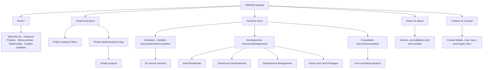

# FERHAN website sitemap

**Source:** `FERHAN WEBSITE.pdf`, especially pages 12 and 14-23.  
**Purpose:** Proposed page hierarchy for the website. Paths below are suggested URLs; the PDF names pages but does not specify URLs.

## Visual hierarchy

## Page inventory

| Page | Suggested URL | Main content and connections | PDF reference |
| --- | --- | --- | --- |
| Home | `/` | Hero; three practice areas; featured projects; About preview; testimonials; contact invitation. The practice cards link to the three service landing pages. | pp. 11, 14-15 |
| Projects | `/projects` | One growing project gallery with category filters. Cards open an individual project. | pp. 12, 15, 17 |
| Project detail | `/projects/:slug` | Project overview, image gallery and similar projects. One route per project. | p. 17 |
| Architects + Builders | `/services/architects-builders` | Overview with six service sections listed below. | pp. 12, 15, 18 |
| Developments | `/services/developments` | Overview linking to four development subpages. | pp. 12, 15, 19 |
| Multi-Residential | `/services/developments/multi-residential` | Development service page. Content is pending in the brief. | p. 19 |
| Townhouse Developments | `/services/developments/townhouse-developments` | Development service page. Content is pending in the brief. | p. 19 |
| Development Management | `/services/developments/development-management` | Development service page. Content is pending in the brief. | p. 19 |
| House and Land Packages | `/services/developments/house-and-land-packages` | Development service page. Content is pending in the brief. | p. 19 |
| Consultants | `/services/consultants` | Overview with five consulting sections listed below. | pp. 12, 20-21 |
| About Us | `/about` | Studio story, Crishan's director profile and accreditations, then short team profiles. No individual team member pages. | p. 23 |
| Contact Us | `/contact` | Clickable phone, email, address/map, opening hours and enquiry form. | p. 22 |

## Content within the landing pages

### Architects + Builders

These are sections on the Architects + Builders page, not separate pages in the current brief:

1. Custom Homes
2. Design & Documentation
3. Extensions & Renovations
4. Construction
5. Commercial & Fit-Outs
6. Project Management

### Consultants

These are sections on the Consultants page. The PDF shows a service tile taking the visitor to its corresponding section:

1. Building Inspections
2. Design Review & Advisory
3. Council Approval Applications
4. Cost, Contract & Builder Advice
5. Engineering Services

### Projects filters

Filters on `/projects` are **Custom Homes, Townhouse Developments, Unit Developments, Multi-Residential, Commercial Fit-Outs,** and **Commercial Projects**. These are filters, not separate pages. The project cards open individual project detail pages.

### Contact form

The PDF asks for first name, last name, email, phone, optional project address, project type, and message/project brief. Project type options are **Custom Home, Renovation or Extensions, Commercial Fit-Outs, Consultation,** and **Developments**.

## Navigation model

- Primary navigation: **Home · Projects · Services ▾ · About Us · Contact Us**.
- The **Services** menu opens **Architects + Builders, Developments,** and **Consultants**. It does not need a separate `/services` page.
- **Featured Projects** on Home leads to the Projects gallery; selecting a card leads to that project's detail page.
- **Testimonials** appear on Home in the PDF. A separate testimonials page is not specified.
- **Team** belongs on About Us. Individual team profile pages are not specified.
- Contact invitations across the site lead to Contact Us.

## Scope note for the current project

The current local implementation starts with a path-selection screen at `/`. Architects + Builders (`/services/architects-builders`) opens the existing full studio site. Developments (`/services/developments`) and Consultants (`/services/consultants`) are future paths with coming-soon pages. The diagram above describes the **PDF's eventual page structure**, while these routes reflect the current staged implementation. The PDF spells the brand **FERHAN**, while the current site title uses **Farhan**; settle the final spelling before publishing page titles and URLs.
